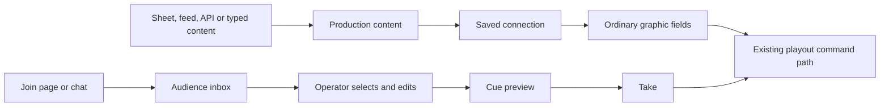

# Second opinion: connect content to graphics

1. Keep production data and the command log; the missing piece is an easy connection workflow.
2. Start at the graphic: choose content, see it in preview, then connect it.
3. Lead with tickers, schedules, standings and credits, not score cells in a Sheet.
4. Offer a small list editor in NoaCG; Google Sheets is optional.
5. Generate starter rows from the chosen graphic's format and current content.
6. Use one tab per reusable set of content, not one tab per graphic instance.
7. Save explicit connections; matching a title is a suggestion within a chosen destination.
8. Keep the data API for fast pushes and RSS for direct news feeds; defer arbitrary JSON URLs.
9. Share source status with Audience, but keep moderation and message delivery separate.
10. Add this as a draft continuation of the production refactor, with a usable prototype first.

Research date: 2026-10-17. Research only; no product code or migration is changed.
Code inspected at `3010e4113`, reconciled with `6cd6f3059`; relevant source files are unchanged.
Both supplied briefs and all four linked specs were read. The current branch already includes
the earlier research and the owner's answers, through merged PR #1377.

I inspected the code before reading the source spec. My initial model was: choose a destination,
choose content, preview the result, save the connection. The existing spec has the right data
plane, but its global name matching and generic row joining make that simple workflow unsafe.
The revisions below are recommendations, not replacement owner approvals. DS1-DS20 and A1-A5
remain recorded; the data and audience specs remain draft.

## The model

For an operator: **Choose what the graphic shows. Edit it here or connect a source.**

For implementation, keep these distinctions behind that short workflow:

| Content | Operator action | Subsequent changes |
| --- | --- | --- |
| A value or a whole list | Connect it to a graphic | Follow while connected, including on air |
| A row from a guest or team table | Load it into a cue | Stay as that cue's copy |
| A viewer message | Edit, put in rundown, Take | Stay as the approved cue's copy |
| Vote totals | Stage a vote board, Take | Follow only with the existing explicit live toggle |



The source does not know the graphic. A saved connection knows the source output, the destination
and its small format adapter. The graphic still receives ordinary field strings. Reuse today's
production tree, `ShowDataset`, cue staging and command log; do not add another general data store.

The connection is graphic-wide today, not cue-specific. Say "Used by 3 cues" in its preview.
Different guests on successive cues use table rows; connecting one live Name would change every
cue using that graphic. Two independent tickers need two graphic instances or a future explicit
cue-level feature. This run should not silently change that scope.

## What works today, and what is actually missing

- `src/model/productionData.ts`: scalar arrays join with newlines; numbers become text; missing
  paths and empty arrays write nothing. Bindings are keyed by graphic name and field id. Manual
  presses on bound fields already write the shared value back through the press boundary.
- `src/control/cueData.ts`: a dataset loads one selected row into cue fields. This is a snapshot,
  not the whole list and not an ongoing live connection.
- `ProductionDataPanel.tsx`: paths, seed controls, Raw JSON, suggestions and Bind all are the
  visible workflow. `ProductionDataWorkspace.tsx` puts tables underneath it. There is no source
  connection action for a Sheet. This corroborates the earlier walk, not a new browser walk.
- `api/data/[...path].ts`: PATCH or POST `/api/data/patch` accepts production JSON; GET
  `/api/data/state` reads it; POST `/api/data/update` addresses graphic fields. A published
  production's bearer data key is required. Requests are capped at 16,384 bytes. Writes have a
  production budget of 25 per five seconds, and the IP prefilter permits 300 requests per minute.
- `/patch` merges objects, replaces arrays and deletes keys on null. Only changed resolved fields
  enter the command log. The current published bindings are the last published copy. New binding
  persistence is part of the planned work, not a capability available now.
- `ProductionAudienceWorkspace.tsx:sendToRundown` still falls back to the first graphic and first
  text field. Title matching also lets a vote board qualify as a message target. #1313 remains
  a concrete reason to require a compatible message target, not just a matching word.

The API already supports a useful integration. Today: publish, connect fields to paths, publish
those bindings, give the sender the key and payload, then Take. The proposed UI removes the
path-writing and hidden republish steps; it cannot remove the sender's integration work.

For example, a future setup assistant can generate this existing-wire-format request from the
operator's selected destinations. These are example keys, not new reserved API names:

```http
PATCH /api/data/patch
Authorization: Bearer <production data key>
Content-Type: application/json

{"match":{"homeScore":2,"awayScore":1},"news":{"headlines":["Doors open at 18:30"]}}
```

It saves the matching connections itself. An integrator sends absolute state, respects 429 and
Retry-After, and keeps the key in their system. No source sends Take, Next or Clear.

## Starter sheets

Recommend **Copy starter rows** for the selected content, with **Download CSV** beside it.
Open the user's new Sheet separately, paste into A1, share it for viewing, then paste that tab's
link back into the same NoaCG connection. Headers and sample rows come from the actual graphic;
use its current content when present. Never require the user to invent a schema.

| Option | Benefit | Remaining work | Recommendation |
| --- | --- | --- | --- |
| Template copy link | Formatting and tabs | Copy, share, link back | Optional examples |
| Generated CSV | Current graphic data | Import, share, link back | Fallback |
| Generated workbook | Several formatted tabs | Import, link tabs | Later |
| Copy starter rows | Current data, no file | Paste, share, link back | First Sheet path |
| Google API creation | Create and discover tabs | Google authorization | Later |
| Paste/type in NoaCG | No source setup | Take the graphic | Simple-list default |

Google documents File > Make a copy [G1], and its own GOOGLEFINANCE help uses a `/copy` link [G2].
That verifies the link pattern, not an API for prepopulating any user's private copy. No signed-in
copy flow was exercised here. Creating an owned Google Sheet requires a Google account; reading
an existing link-shared Sheet does not require connecting that account to NoaCG [G3]. NoaCG must
not promise "create your Google Sheet with no Google sign-in". API creation is a separate
authorized Google integration [G4]. CSV/Excel import is documented [G5].

Use one workbook per production when convenient, with one tab per independent content set.
Two graphics showing the same headlines share one tab and one reader. Two different tickers get
two tabs. Do not give everyone a workbook with every catalog type; most tabs would be irrelevant.
The first release generates the selected tab's rows, not a complex universal workbook.

### Concrete layouts

These are proposed starter formats, not existing import support. The first row is a header.
Tab names are human labels. The saved connection, not the tab name, chooses the destination.
Display headers below are adapter inputs and need not equal long catalog field titles.

**News** for a ticker. One column is enough; a category column can be an optional preset later.

```text
Ticker items
Doors open at 18:30
SPORT: United win 3-0
Tickets available at the entrance
```

Each row becomes one item in `f0`. All 22 catalog tickers use `parseTickerItems` in
`src/templates/tickers/shared.ts`. Its colon, semicolon and tab kicker conventions are preserved
and shown in preview. The bilingual ticker needs its own two-language preset, not a generic
second column. An external title containing a colon can change its presentation; preview it.

**Tonight** for a schedule, such as ig06.

```text
Time     Programme
18:30    Doors open
19:00    Opening match
20:15    Finals
```

Serialize to `18:30 | Doors open` in `f0`. `scheduleRowsRuntimeJs` splits at the first pipe.
The Time cell stays display text, including leading zeroes. The graphic's heading stays a normal
cue field unless the operator separately connects it.

**League** for a standings board, such as st01.

```text
Team       W    L    +/-    PTS
United     4    1    +14    12
Rovers     3    2    +6     9
```

Serialize body rows to `United | 4 | 1 | +14 | 12` in `f2`, and the headers after Team to
`W | L | +/- | PTS` in `f3`, as one consistent update. The original plan missed the separate
column-header field in `STANDINGS_FIELDS` and `STANDINGS_RUNTIME_JS`. A generic cells-to-line join
alone can put new figures under old column labels. Preserve row order; do not invent sorting.

**Credits** for an end-credits graphic.

```text
Role           Name
# PRODUCTION
Producer       Alex Riva
Camera         Sam Chen

# THANKS
Venue          Central Hall
```

Role and Name become `Role | Name`; a heading becomes `# PRODUCTION`. An internal blank row is
a section break, not noise to discard. Trim unused trailing blank rows only. The current credits
parser explicitly uses blank lines to close sections. A guided native editor can offer Add
heading and Add section; the Sheet format should preserve them without a formula.

**Guests** for lower thirds such as lt01. This is a row-selection table.

```text
Name           Title
Alex Riva      Presenter
Sam Chen       Analyst
```

Choose Alex, load into cue preview, then Take. Selecting Sam for a later cue does not change Alex
on air. A lower third showing one changing speaker can explicitly use a live value instead.

**Match** for a scoreboard. Supported, but not the promoted way to operate scores.

```text
Field          Value
Team A         United
Team B         Rovers
Score A        2
Score B        1
Clock          43:12
```

Generate the labels from the selected board, not these example names. Connect Score A to the
same shared score used by a second board only when the operator chooses "Use existing data".
Ordinary score changes remain NoaCG buttons or an external scoring system's API pushes.

### How NoaCG finds tabs

A CSV response contains one tab's cells, not its title, other tab ids or an embedded manifest.
The share link's `gid` selects that tab. A header cannot tell NoaCG where the other tabs live.
The prior cross-origin export measurement is useful, but it does not prove tab discovery.

For this run, paste the selected tab's link once for each distinct tab. Deduplicate readers by
workbook and tab identity. If `gid` is absent, show the returned first tab's sample and require
the user to choose it or paste the intended tab link. Do not assume gid 0 always exists.
Renaming a tab keeps its saved id; deleting or recreating it needs an explicit reconnection.

The official Sheets API exposes workbook sheet metadata, including titles and sheet ids [G6].
It is a possible later tab-picker implementation with an appropriate Google API access model.
It is not supplied by anonymous CSV. Google's documented Drive CSV/TSV export is first-sheet
only [G7]. Scraping workbook HTML or undocumented all-tab downloads adds fragility, not a reliable
zero-step connection. A manifest tab still needs a supported way to discover the other gids.

## Connection rules

1. The user chooses a graphic and content slot before import. Generated rows carry that context
   in NoaCG. The user never types an internal path or field id.
2. Validate headers inside that selected format. Show the parsed rows and rendered preview.
   Compatible generated headers map automatically; arbitrary headers get a short column picker
   with sample values. Do not guess globally from a word such as Name, Title or Rows.
3. Save source id, output key, graphic identity, field identities and format version. Display
   names may change. Use the existing graphic id and adapt to legacy name-keyed bindings at the
   current runtime boundary. A graphic replacement or changed field contract needs revalidation.
4. A connection owns its destinations. A later source cannot seize them because its first push
   contains the same label. Offer reuse or replace explicitly. Existing explicit bindings stay.
5. Reuse the same content by selecting "Use existing data" on the second graphic. That is how
   one score feeds two boards. Sharing the text Name is not evidence of sharing a person.
6. Use source-scoped internal keys for newly managed content. Keep the current data API and old
   paths working. All senders using today's single production data key are one API source; do
   not claim per-sender provenance or independent pause without new credentials and identity.
7. Keep D4: manual edits affect the shared value; unchanged polls do not undo them. A changed
   source value wins next. A list is one value, so any changed row can replace its manual edit.
   Pause holds it; Resume compares with the last applied source snapshot, not a later observed
   snapshot. Partial API patches while paused must merge into held state, including deletions.
8. Distinguish failed fetch, malformed content, missing column and valid empty content. Failure
   retains last good values. Empty content clears only under the new source contract; do not
   globally change legacy `formatValue([])` or missing-path behavior without compatibility tests.
9. Save connection changes durably for published productions, then report Connected. Order them
   with source writes so a late response cannot update a disconnected or replaced target. Local
   mode uses one browser owner; published mode uses one server owner and fenced handover.
10. Connecting an already on-air graphic can change it immediately. Preview the effect and name
    the affected graphics before applying. Data updates never cause a Take by themselves.

The format registry should be small and typed: text lines, schedule, standings, credits and
selected-row fields. It belongs beside data resolution, not in a new expression engine. Keep
ordinary textareas as plain text; multiline text is not automatically a list. Reject or explain
embedded newlines and unsupported delimiters per format rather than silently splitting rows.
Changing a format must not rewrite templates or their exports.

## The data page

Keep it as a useful overview, not a prerequisite for connecting anything. A first visit shows
the production's content with real values and the graphics using it. No terminology lesson.

```text
Data                                                + Add data

News              3 items     Used by: Evening ticker
[inline rows or preview]       Typed here      Connect...

Tonight           3 rows      Used by: Coming up
[inline rows or preview]       Google Sheets   Open sheet   Pause

Match             2 - 1       Used by: Scorebug, Full scoreboard
                               Custom API      Received 2 s ago   Pause

Advanced
```

The same small editor opens from the cue field. This is list entry and paste, not a spreadsheet
clone: no formulas, cell addressing or competing score console. Source-managed rows show their
source and an explicit manual-override action. Advanced keeps the existing JSON, paths and seed
tools. A stable Data tab sits beside Playout and Audience; Setup does not add or remove tabs.

A compact status area in Playout shows connected sources and problems, with access to Pause.
Keep "last checked" separate from "last changed": an unchanged successful poll is healthy.
For push sources, silence alone is not failure unless an expected interval is configured.
Receiving one API push does not establish that a sender will remain healthy indefinitely.

## The shortest complete journeys

- **Typed or pasted list:** select the ticker, paste rows, preview, Take. No Sheet required.
- **Existing Sheet:** select graphic, Connect > Google Sheet, paste tab link, confirm preview,
  Take. The destination supplies the format; an arbitrary sheet may need column selection.
- **New Sheet:** Copy starter rows, create Sheet, paste, share, paste tab link back, preview,
  Take. Return visits are just editing rows in that Sheet.
- **RSS/Atom:** select ticker, Connect > News feed, paste URL, preview, connect, Take. No Sheet.
- **Custom push:** select destinations, choose Custom API, publish if needed, copy generated
  setup to the sender, send a sample, verify the preview, Take. Later pushes follow on air.
- **CSV or other spreadsheet:** paste rows or import a CSV into the native content editor.
  It is a snapshot; this run does not promise a live Excel connection.
- **Arbitrary JSON endpoint:** keep deferred. A technical integrator transforms it into an API
  push. A JSON Feed format could later be another feed parser; it is not arbitrary JSON mapping.
- **Audience:** enable messages, share join link or connect chat, select and edit a message,
  Put in rundown, Take. Offer a compatible question card when none exists. Never use a scoreboard.

## Freshness and source lifecycle

Primary pages were fetched directly on 2026-10-17, unlike the earlier extract-based research.
These are documentation findings, not latency measurements or end-to-end provider tests.

| Mechanism | What the current primary documentation establishes |
| --- | --- |
| IMPORTFEED, IMPORTDATA, IMPORTXML, IMPORTHTML | Settings lists one hour [G8] |
| IMPORTDATA, IMPORTHTML, IMPORTXML | Hourly checks while the document is open [G9] |
| IMPORTRANGE | Settings says 30 minutes; its own help says hourly while open [G8], [G10] |
| GOOGLEFINANCE | Quotes may be delayed up to 20 minutes [G2] |
| Apps Script timers | As often as every minute; timing can be randomized [G11] |
| Apps Script quotas | Trigger runtime 90 min/day personal, 6 h Workspace [G12] |
| Sheets API | 300 reads/min/project and 60/min/user/project; same write limits [G13] |
| Zapier polling | Polling speed depends on plan; instant triggers differ [A1] |
| Make scheduling | Minimum interval depends on plan; some triggers are immediate [A2] |
| n8n schedule | Supports seconds, subject to execution and source constraints [A3] |

G9's hourly-open sentence names three functions, not IMPORTFEED. Do not extend its precise
condition to every import formula. G10 also describes reload behavior on opening and chains;
the conflicting Google pages do not establish a dependable live-data SLA. Export polling is not
documented as activating formula recalculation. NoaCG's five-second polling target concerns
available Sheet edits, not the upstream feed freshness. Keep D3's measurement gate.

RSS 2.0 [F1] and Atom [F2] justify a simple title list. Keep DS4's newest 20 and five-minute
default, conditional requests and publisher backoff. Dates may be absent or invalid: preserve
document order for ties or undated items rather than inventing timestamps. Reuse stable item ids,
then links, with a deterministic fallback. Normalize titles to plain text and bound XML parsing.
The fetcher must protect every redirect and DNS resolution, enforce body and time limits, and
share cached fetches. This is a necessary feed boundary, not a general URL proxy.

vMix's data-source guide [B1] confirms reusable sources feeding title fields. Its mapping guide
[B2] shows selecting a field, source, table and column, with a preview and a selected-row option.
Keep that interaction pattern and NoaCG's explicit Take boundary. Do not copy its fallback to
column position when a name fails to match. Its source-types guide [B3] confirms Sheet API-key
setup and object-array JSON input. These are real setup costs, not evidence of automatic mapping
for arbitrary data. NoaCG also works with SPX, CasparCG and OBS; no new claim about those products
is needed here. SPX docs returned HTTP 403 in this session. This is not a new 15-product survey.

Audience should share identity, persistence, status and Pause components with other sources.
It should not pretend that polling a Sheet, receiving a PATCH and holding a chat connection are
the same "fetch and parse" function. Use polling, push and subscription runners with narrow
destination interfaces. A scheduler can initiate bounded work; it cannot itself hold an IRC or
streaming connection open. Choose and measure a durable listener before promising A4.

Twitch's documented chat path requires authorization [C1]; anonymous IRC is not a supported
product guarantee. YouTube recommends streamList [C2], [C3]. Both list and streamList currently
document five quota units per call; polling must honor pollingIntervalMillis. A reconnect is
another call, and streaming is not a promise of unlimited free messages. Do not introduce new
platform sign-in here without an explicit product decision; record a blocked provider honestly.

## What to change or drop from the plan

| Decision | Recommendation | Reason |
| --- | --- | --- |
| DS1, DS10 | Keep shared content, make the chosen graphic the entry point | No naming lesson |
| DS3 | Replace universal joining with the small format registry | Headers and sections matter |
| DS7, sheet AC-2 | Stop global first-push/title auto-binding | Equal labels do not prove intent |
| DS9 | Isolate source outputs; explicitly share or replace | Avoid accidental competing writers |
| DS14, A1 | Stable Data and Audience tabs, shared source status | Predictable navigation |
| DS16 | Prototype both pages, then data and audience work | Test the hard UX early |
| A4 | Shared management, distinct subscription runner and feasibility gate | Chat is not polling |

Keep DS2, DS4-DS6, DS8, DS11-DS13, DS15 and DS17-DS20 in intent, with the edge cases above.
Keep A2, A3 and A5. Keep D1, D3 and D4; DS2 already revises D2's priority to lists first.
Do not replace accepted decisions silently. The five proposed revisions P1-P5 in the data spec
group these changes for review; the owner need not answer the original 25 questions again.

Drop universal template workbooks, name-derived identity, a general mapping language, a required
Sheet for plain typing, arbitrary JSON selectors, a second scoring UI, and one forced runner for
all source kinds. Defer OAuth creation and all-tab discovery until their value justifies setup.

## Risks and what remains unverified

- No browser walkthrough or signed-in Google action ran in this session. The earlier UI walk
  is attributed; the current findings are from code and primary documentation.
- No owned Sheet was edited. Twenty edits, one hour of polling, CORS in a real browser, edit
  latency, throttling and server cost remain explicit preimplementation measurements.
- A fresh anonymous CSV fetch of Google's linked sample failed with a proxy tunnel HTTP 403.
  No export/CORS result is claimed from it; the 2026-10-16 measurement remains prior evidence.
- CSV export remains an undocumented delivery surface. Google policy, sharing restrictions and
  download permissions can prevent access. Do not infer current freshness from a no-cache header.
- Global name matching is already in the draft, not today's automatic behavior. Existing saved
  bindings need a compatibility path, not a mass rewrite or a newly invented wire API.
- Empty-list clearing, pause/resume, live binding persistence and server-owned readers are
  planned behavior. Node and database conformance must agree before any UI promises them.
- No real feed polling soak, live chat session, output device or hosted-account journey ran.
  Browser closure, reconnect deduplication, quotas and published moderation require evidence.
- On-air setup, reconnect and graphic replacement can affect a running graphic. Show the exact
  preview and affected destinations, preserve last good values on failure, and test ordering.

## Primary sources read

[G1]: https://support.google.com/docs/answer/49114?hl=en
[G2]: https://support.google.com/docs/answer/3093281?hl=en
[G3]: https://support.google.com/drive/answer/2494822?hl=en
[G4]: https://developers.google.com/workspace/sheets/api/guides/create
[G5]: https://support.google.com/docs/answer/9331167?hl=en
[G6]: https://developers.google.com/workspace/sheets/api/guides/concepts
[G7]: https://developers.google.com/workspace/drive/api/guides/ref-export-formats
[G8]: https://support.google.com/docs/answer/58515?hl=en
[G9]: https://support.google.com/docs/answer/12188454?hl=en
[G10]: https://support.google.com/docs/answer/3093340?hl=en
[G11]: https://developers.google.com/apps-script/guides/triggers/installable
[G12]: https://developers.google.com/apps-script/guides/services/quotas
[G13]: https://developers.google.com/workspace/sheets/api/limits
[A1]: https://help.zapier.com/hc/en-us/articles/8496244568589
[A2]: https://help.make.com/schedule-a-scenario
[A3]: https://docs.n8n.io/integrations/builtin/core-nodes/n8n-nodes-base.scheduletrigger/
[F1]: https://www.rssboard.org/rss-specification
[F2]: https://www.rfc-editor.org/rfc/rfc4287
[B1]: https://www.vmix.com/help29/DataSources.html
[B2]: https://www.vmix.com/help29/DataSourcesTitleMapping.html
[B3]: https://www.vmix.com/help29/DataSourcesTypes.html
[C1]: https://dev.twitch.tv/docs/chat/
[C2]: https://developers.google.com/youtube/v3/live/docs/liveChatMessages/list
[C3]: https://developers.google.com/youtube/v3/live/docs/liveChatMessages/streamList
