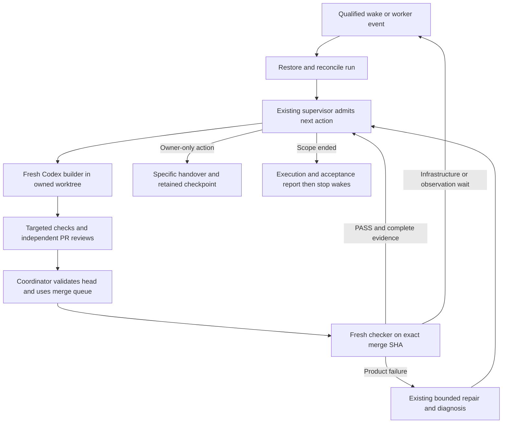

# Autonomous planned runs in Codex

Assessed 7 November 2026 against repository `fee8818c9fb20317548c1213538b07bab41b4c7b`, confirmed as remote main during this review, and current GitHub run discussions. This is a proposed implementation and qualification plan. It does not start, reopen or transfer any product run.

The existing planned-run system is worth keeping. Claude Code demonstrated useful unattended delivery over many days, with independent checks finding real defects. Codex already has most of the repository machinery it needs. The remaining work is to connect that machinery to a proven Codex execution and recovery route, make recovery use current decisions, and distinguish completing phases from achieving the intended outcome.

The operating goal should be **days or weeks of authorized progress without routine human restarts**, across many bounded sessions. Individual agents and machines can stop. The run must retain its work, resume safely, wait through temporary outages, land verified changes and stop at the owner's actual boundaries. One enormous uninterrupted conversation is neither necessary nor sufficient.

## What the previous runs demonstrate

| Run | Observed delivery | Qualification and lesson |
| --- | --- | --- |
| Production page, [#1553](https://github.com/NoaCG/NoaCG-Studio/issues/1553) | The coordinator's [retrospective](https://github.com/NoaCG/NoaCG-Studio/issues/1553#issuecomment-6496870487) reports 50 cloud phases in about eight days, 58 phase/repair merges, eight product FAILs and five additional owner-requested fixes. | Fresh independent checkers found duplicate-revision and lost-score defects after builders' reviews had passed. Preserve this separation. Software completion was followed by real studio feedback and more fixes; software PASS did not imply production acceptance. |
| Jev SVG import, [#1850](https://github.com/NoaCG/NoaCG-Studio/issues/1850) | Started 31 October; all 40 phases finished by 3 November, through the merge queue and independent exact-merge checks. The [closing receipt](https://github.com/NoaCG/NoaCG-Studio/issues/1850#issuecomment-6618120601) and [release kit](../work-specs/jev-svg-import/evidence/phase-40.md) describe the delivered scope. | The model lost its preregistered holdout comparison and correctly shipped disabled. Deterministic SVG import remained useful. Paid inference was $0.045931275 of the $5 ceiling, 284 of 500 attempts; this is not the cost of the coding agents. Autonomous decision-making must be able to conclude no-go without inventing a new goal. |
| CI/CD improvement, [#1842](https://github.com/NoaCG/NoaCG-Studio/issues/1842) | Started 31 October; [finished 2 November](https://github.com/NoaCG/NoaCG-Studio/issues/1842#issuecomment-6567582441). All 18 phases landed and passed their phase checks. | The [final criterion review](../work-specs/cicd-improvement/evidence/phase-ci17.md) marked one of eight initial criteria met, one not met and six pending. Phase delivery succeeded; the overall improvement targets were not achieved. Some goals required observation windows, matched samples or separately authorized work. |
| Editor | Many engineering slices, native/local checks and repeated independent save/leave checks already exist. The plan remains unfinished. | Repeated repair cycles exposed missing state rules across Save, autosave, navigation, conflicts and reload. Later owner decisions deliberately narrowed the acceptance scope. Continuing requires reconciliation, not replaying the oldest failed check or treating every historical gap as fresh authorization. |

Production page was [closed by the owner on 6 November](https://github.com/NoaCG/NoaCG-Studio/issues/1553#issuecomment-6686105172) after three studio sessions. Its receipt reports 50 cloud phases passed, useful hardware/rehearsal successes and a failed CasparCG restart. Formal ledger entries for the two owner phases and the final E8 reconciliation were not written. Owner closure should be representable without falsely turning these into full technical PASSes.

The production-page retrospective is a coordinator report, not an independently reconstructed timing dataset. Its cost estimates of roughly $5 to $95 per session are self-reported and do not establish subscription billing or a Codex budget. The CI/CD final report provides more structured timing: the two-plan co-run had queue-to-landing p50 9.9 and p90 12.4 minutes, but lacked a matched comparison cohort. It cannot establish faster throughput from parallel runs.

An apparent order violation, [#1934](https://github.com/NoaCG/NoaCG-Studio/issues/1934), was [withdrawn after timestamp reconciliation](https://github.com/NoaCG/NoaCG-Studio/issues/1934#issuecomment-6564847774). The corrected evidence shows all 26 judged successors started after their predecessor's check. It is not evidence of a broken admission gate. Preserve raw event times and provider anomalies when measuring runs.

## What worked and should remain

Keep one thin coordinator, fresh phase builders, fresh independent acceptance checkers, exact source and merge identities, the GitHub merge queue, explicit retry limits, and one acknowledged repair owner per PR. Checkers should receive the contract and evidence, without the builder's conversation. Their independence does not require buying a different model; it requires a fresh context and their own probes.

Keep the existing wave ledger and `run-supervisor.mjs` as execution authority. Keep `work.json` as acceptance evidence, the kit as operational context and the issue heartbeat as a rendered view. None should become a competing task scheduler. Preserve owner permissions once, then reuse them through bounded work blocks. Machine-verifiable work should not routinely go back to the owner.

The successful Claude route had native `create_session`, status/events, follow-up, results and `send_later`. The [CI launch receipt](https://github.com/NoaCG/NoaCG-Studio/issues/1842#issuecomment-6541029560) records a wake into a freshly booted container with the worktree intact. It expressly leaves archived revival, wake during a usage-limit stop and remote ownership fencing unqualified. Claude's success is practical evidence, not proof that every possible outage already recovers autonomously.

## Audit of the current skills and runner

Read together: [plan-create skill](../../.agents/skills/plan-create/SKILL.md), [creation procedure](../../.agent-workflows/plan-create.md), [plan-run skill](../../.agents/skills/plan-run/SKILL.md), [execution procedure](../../.agent-workflows/plan-run.md), [cloud routing](../../.agent-workflows/cloud-delegate.md), [known traps](../plan-runs/known-traps.md) and all four brief templates.

### Improvements already implemented

Most of the production-page retrospective's operational recommendations now exist. Implementing them again would add complexity without solving Codex continuity.

| Concern from the retrospective | Current implementation |
| --- | --- |
| Run creation mixed with execution | Separate plan-create and plan-run, with shared Claude/Codex procedures. |
| Large mutable trigger prompts, duplicated briefs | `plan-kit.mjs`, small `state.json`, stored briefs, shared templates and known traps. |
| Local-only operational context | `run-recovery.mjs` publishes ledger, kit and authorization to a recovery ref; restoration tests cover missing local state. |
| Daily block ceremony | Separate standing `untilComplete` and `blockRenewal`, immutable planning target, blocks of at most 24 hours and supervisor renewal. |
| Fixed empty check-ins and owner-phase launches | Adaptive `plan-kit checkin`; owner phases produce a handover and no check-in. |
| Inconsistent stamp/auto-merge ownership | Coordinator owns the stamp and auto-merge after worker gates; one repair owner stays responsible. |
| Shared configured-suite pending slot | Current procedure uses candidate identity and per-branch dispatch/concurrency; selected configured checks feed the PR CI gate. Verify current workflows when implementing the adapter. |
| Drift, duplicate numbering and new admitted phases | Stable IDs, current-state rereads before docs land, and owner-receipted supervisor admission. |

### Remaining gaps

1. **The shared procedure is more portable than its templates.** `check.tmpl` still creates `.claude/worktrees/check-…` and dispatch branches named `claude/check-…`, even when the kit's `branchPrefix` is Codex. `plan-kit.test.mjs` currently asserts the Claude dispatch branch. The cloud browser-image workaround in known traps is also a dated Claude-image observation. A Codex run must use its qualified paths and image, not mechanically replay those instructions.

2. **Recovery state is not an execution backend.** `continueProject` restores the project with an adapter that answers native requests `unknown`; the procedure explicitly forbids using `tick` for these continued projects. The coordinator must perform the actual next action. `native-recovery-contract.mjs` validates receipts but calls no provider. Passing these tests does not provide a hosted Codex launcher or a durable wake.

3. **The short preflight does not prove unattended readiness.** `plan-run-preflight.mjs` checks the current subprocess, workspace and Git/API reads. Its `qualificationGaps` still lists native Codex child mapping and wake/bootstrap after host loss. Replace unconditional gap text with separately recorded capability observations; never promote ordinary read access into write, wake or recovery permission.

4. **Current decisions are distributed across records.** The runnable list still calls Jev preparation-only although #1850 is finished. Editor phase notes retain a blocked October 19 handoff although a later closure supersedes it. Plan-create must inspect current run and owner decisions before interpreting an old registration as something new to open.

5. **The final phase can legitimately pass while the goal stays open.** CI17 accurately reported unmet goals, so its phase PASS was correct. The heartbeat's “finished: every required phase … passed” does not communicate the same thing. Display execution disposition, acceptance result and remaining observation separately, using existing authorities.

6. **Not every unresolved measurement is a reason to end the improvement programme.** If authorized scope includes an observation period, retain a durable wait and wake to collect it. If more product work or a new cohort is outside scope, report the gap and obtain that specific decision. Do not quietly invent work or call a report-only phase success of the whole plan.

7. **Long-run decision handling needs explicit operational categories.** Existing verify guidance already delegates reversible engineering choices. The runner should preserve whether an item is a product failure, infrastructure wait, ambiguous delivery, exhausted repair, owner-only action or accepted deferral. Context loss must not turn any of them into a fresh attempt.

8. **Block renewal needs a joined scheduling test.** `plan-kit.checkin` can choose the exact block deadline, while `rearmNative` refuses a next wake at or beyond that deadline. Their behavior must be reconciled in the selected integration, so the last block's wake can safely hand over to authorized renewal without silently breaking the chain. This is a source-level contract gap to test, not an observed failure of the completed Claude runs.

## Codex capability assessment

This review used the Cloud runtime qualification guidance and read the current tool schemas rather than assuming the October interface remained unchanged. Observations on 7 November:

| Capability | Current evidence | What remains to prove |
| --- | --- | --- |
| Managed cloud workspace | Current environment is connected, observations current and network policy enforced. Repository source and remote main agree. | Lifetime and replacement behavior are not established by readiness metadata. |
| Git/API read access | `cloud-network-preflight.mjs` passed Git origin/main and Actions API reads with supported network permission. Connected GitHub tools read run issues and comments. | Write, workflow-file push, review stamping, auto-merge and whole-log return are separate operations. |
| Same-machine workers | Collaboration tools are exposed. Earlier [Codex qualification](../work-specs/renewable-plan-runs/evidence.md) proved a fresh worker and follow-up; the Jev qualification chat reported workers, independent checking, browser execution and active-session wake/landing. | No new worker was launched for this analysis. Independent contexts on one VM share its failure and resource limits. They do not prove separate hosted children. |
| Hosted child launch | Installed CLI is 0.159.2; `cloud exec/status/list/diff` are advertised. `exec` advertises managed worktrees, JSON events, structured output and resume; `queue` targets existing sessions. | Help is not authenticated execution. October 30/31 cloud inventory returned 401. No new denied probe was repeated, credentials changed or task submitted. Mapping to the intended saved configuration remains unqualified. |
| Scheduled continuation | The exposed automation API can report inherited cloud configurations, coding thread IDs and run history. A read-only inspection of the prior “Qualify Codex recovery” task returned its thread/environment metadata. | That task's latest run/result were null and delivery status unknown. `last_run_time` and inherited configuration do not prove coding execution or interruption recovery. The create input has no explicit coding-thread/environment selector; inherited targeting must be observed. |
| Persistent state | Git-backed checkpoints and local restoration/fencing tests exist. | Native resumption after the supported interruption, workspace reconstruction, uncertain launch reconciliation and rejection of stale external actions need real receipts. |

The October 30 chat **Qualify Jev SVG launch prerequisites** (`01a18e77-c25c-706d-b3e9-53afee5ed07d`) reported an active-session wake and merged qualification PR #1825, but explicitly left unattended recovery unproven. [#1301's October 31 follow-up](https://github.com/NoaCG/NoaCG-Studio/issues/1301#issuecomment-6540584271) preserves the worker-authentication and coding-wake gaps. Read those together: neither “no scheduler exists anywhere” nor “Codex unattended recovery is ready” is justified.

Do not change the canonical owner binding to the current runtime ID. Saved configurations, executor instances, native sessions and CLI environment selectors are different identities. Record their actual relationship when the supported route proves it. Environment names and matching repositories are insufficient.

## Recommended operating design

Use the existing supervisor to drive many short, replaceable Codex sessions. Persist intent before dispatch, reconcile before replay, and checkpoint after every accepted event. Preserve the same run ID, scope, consumed attempts, source identities and owner decisions across replacements.

Prefer the supported managed Codex Cloud route once qualified. Fresh same-VM workers are a useful execution option for a serial run, if that topology is explicitly selected and the environment has capacity; they are not equivalent to separately hosted children. The current run authorization may require the latter, so topology changes must be recorded rather than disguised.

If managed Cloud cannot supply native recovery, the alternative is the same Codex CLI and supervisor on a persistent user-controlled cloud machine, supervised outside the agent process. This can remove dependence on a coding chat's wake, but needs a hosting, credential, subscription and operational-ownership decision. Do not provision it or silently switch an existing run. The earlier [durability research](durable-orchestration.md) proposes Temporal for a future hosted control plane; defer that deployment until a demonstrated platform gap requires it. A new orchestration framework does not solve missing worker authorization.

### Tests and landing

Continue the existing targeted worker checks and authoritative Actions checks. Collect evidence once per exact revision and reuse only results whose scope and identity match. Read configured selection and its verdict; do not automatically dispatch a second full configured suite for each review head. Preserve test budgets, limits and same-commit failure history.

The builder ends with its reviewed SHA, CI/selection, independent review result and PR. The coordinator rechecks the live head, posts the normal stamp and enables auto-merge through the repository queue procedure. A moved head invalidates the old approval. A fresh checker independently judges the merge SHA and its required post-land results. Required combined-tree checks must be read from current configuration, not assumed from the historical CI/CD run.

Reconcile the existing worker, PR, queue and Actions runs before replacing anything. Unknown delivery stays unknown; a lost reply is not permission to launch another worker. Repair ownership survives coordinator replacement and remains exactly one acknowledged owner, including base conflicts that produce no webhook.

### Decisions without routine interruptions

| Situation | Autonomous behavior |
| --- | --- |
| Reversible implementation choice within acceptance | Decide, record the reason and verify it. |
| Objective go/no-go rule, such as Jev holdout acceptance | Apply the preregistered rule, preserve the rejected route and continue the authorized fallback. |
| Product failure | Carry all findings into the existing repair/diagnose sequence; preserve spent attempts. |
| Temporary CI, provider capacity or review-service outage | Persist a wait, back off and reconcile; consume no product repair attempt. |
| Usage stop | Resume at a known reset if authorized and supported; unknown reset remains a wait. Never substitute credentials, billing pool, model or provider. |
| Unrelated failing test | Establish the permitted control evidence and record the coordinator's scoped decision; never weaken a judge to clear the run. |
| Changed product scope, unusual expenditure, important external/privacy boundary or owner-only action | Ask the specific question with the proposed choice; checkpoint the dependent item and continue only already-authorized independent work. |
| Owner pause, cancellation or exhausted attempt allowance | Stop launches and automatic continuations as the existing procedure requires; preserve recoverable work. |

Where repair findings repeat the same state-rule family, use the existing risky-change and repeated-family reassessment before another patch. The editor's long Save campaign is the reason to do this early. The reassessment does not grant another attempt.

## Implementation sequence

These are proposed engineering work packages, not newly authorized product phases. Preserve existing Claude runs and receipts. Estimate engineering effort separately from platform lead time and elapsed soak/observation time.

| Package | Change and intended files | Acceptance and dependency |
| --- | --- | --- |
| P0 Resolve launch capabilities | Reconcile #1301 and current launch decisions. Produce a dated, content-minimal capability receipt using existing cloud-execution evidence conventions. | Identify the actual native launch/status/follow-up/result/wake route and environment mapping, or name the unsupported operation. Prove a fresh independent context, delayed coding execution, one bounded re-arm and terminal stop before an unattended product start. A scheduled acknowledgement is insufficient. |
| P1 Make briefs portable | `plan-kit.mjs`, four templates, known traps, plan-create/run wrappers and shared procedures. | Codex briefs contain owned Codex worktree/check branches and the selected runtime's browser instructions; Claude briefs still work. Exact source/merge pinning and receipt independence survive. Test both renderings and fresh root/nested instruction loading. This can proceed while P0 is blocked. |
| P2 Connect execution to existing authority | Extend the existing supervisor/native adapter seam and recovery contract; do not add another task ledger. For continued projects, choose one supported coordinator/adapter route explicitly. | Every external launch/follow-up has a recorded intent and receipt; ambiguous acceptance cannot duplicate delivery. Re-entry restores the kit and reconciles worker/PR state before admission. Owner pause, stale owner, block end and exhausted attempts are enforced. Depends on P0 for live qualification; fixture development can proceed independently. |
| P3 Resolve current decisions and outcomes | Plan-create preflight, plan-kit heartbeat, recovery brief and relevant registration/launch metadata. | Detect completed/owner-closed runs before opening one. Prefer explicit later owner decisions over superseded handoffs, retain historical failures and link decisions. Report phase progress separately from unmet/pending overall ACs. Authorized observation waits continue without inventing scope. |
| P4 Automate the landing evidence handoff | Existing candidate-dispatch, landing records and queue-merge seam; structured worker/checker receipts. | One legitimate pilot change goes builder → PR reviews → current-head stamp → queue → exact-merge checker → terminal repair-owner receipt without owner clicks. Read full required logs and selected checks. Demonstrate moved-head refusal, duplicate-event tolerance and base-conflict detection. No test weakening or direct main write. Depends on P0–P2. |
| P5 Qualify failure and recovery | Existing supervisor/recovery/authorization/native-contract tests, plus a bounded live qualification run. | Exercise coordinator termination, supported environment replacement, missing local state, lost acknowledgement, delayed CI, service/usage wait, expired block, owner pause/cancel and stale ownership. Restore the same run and attempts; no duplicate phase or unreviewed merge. A local process-kill fixture alone cannot close the native cases. |
| P6 Run a bounded Codex pilot | One explicitly authorized, low-risk three-phase engineering slice, with distinct builder/checker contexts and the existing ledger/kit. | Complete and independently check all three exact merges, including a controlled interruption/re-entry and block renewal. Measure build-to-PASS, review/queue wait, runner-minutes, repairs, unplanned owner interventions and missing evidence. Then demonstrate at least 72 hours of unattended service with useful authorized work, not dummy PRs. |
| P7 Continue a bounded editor journey | Reconcile the current editor acceptance register and dated closure; prepare only the next authorized, useful outcome. | Start from current main while retaining historical acceptance pins. Run the complete browser task, save/reopen, source/history preservation and applicable output checks; review rendered results. Do not reopen the closed conflict campaign, grant new attempts, claim physical-device acceptance or switch the default editor. Depends on P3 and a passing P6. |
| P8 Establish sustained operation | Extend the same measured pilot to seven days, then fourteen when sufficient authorized work exists. | No routine owner restart; every merge retains exact-head and exact-merge evidence; every interrupted action reconciles; all daily blocks preserve authority; no stale owner can stamp or launch; stop leaves no active wake or ownerless PR. Report service downtime and human interventions, not just a green final run. |

P0 and a live landing cycle should settle feasibility before weeks of adapter work. If P0 fails on a platform capability, finish P1/P3 and the fixture work that remain useful, then present the precise managed-Cloud blocker and the persistent-host alternative. A blocked product project is not needed to investigate readiness.

The current automation interface permits no more than hourly scheduling. The existing kit often wants a 30-minute idle check or an immediate action. The implementation must use proven completion events/live bounded waits for faster responses, and explicitly accommodate the scheduler's actual frequency and block-end behavior. Never claim a 30-minute recovery bound from an hourly-only route. Avoid a new exact-cadence experiment unless a product requirement needs it; useful recovery needs reliable eventual execution with a stated bound, not perfect timing.

### Qualification results to retain

For each live drill record the run/action IDs, native session and configuration mapping, policy fingerprint, branch and full SHA, intended/delivered wake times, before/after boot identity, persisted/restored checkpoint, observed external state, and terminal cleanup. Keep credential values, user artwork, private context and raw transcripts out of public recovery artifacts. A recovery branch in this public repository is not private storage.

Local SQLite transactions and Git compare-and-swap protect local admission and checkpoint publication. They do not establish an atomic lock where a provider accepts an external launch or GitHub accepts a stamp. Test those boundaries or retain a conservative single-owner constraint; do not claim exactly-once execution across hosts.

## Continuing the editor in Codex

The editor is a good eventual pilot because much of its functional acceptance can be automated, but it is a poor first test of an unqualified recovery backend. Its persistence, state transitions and shared source make simultaneous implementation especially costly.

Read [EDITOR_PLAN](../EDITOR_PLAN.md), the [acceptance register](editor-acceptance-register-2026-09-17.md), [rebuild notes](../EDITOR_REBUILD_PLAN.md), and the **current disposition at the top** of [leave-editor reliability](../work-specs/editor-leave-reliability/README.md). The [21 October scoped closure](../work-specs/editor-leave-reliability/scoped-closure/README.md) supersedes the older blocked handoff:

- Phase 2 was owner-accepted only under a bounded single-device scope, at `12eccdd8533ba710f0917cb3bcc78101070ecca8`.
- One active authoring tab/device per account and sequential handoff remain operating restrictions. Physical receiving devices and concurrent authoring are not accepted by that receipt.
- Step 6 is complete. #1466 is closed; this review read its current GitHub state. Do not revive the earlier reservation merely because an older PR handoff says it remains held.
- No Phase 3, newer-main qualification, fresh diagnostic allowance or default-editor switch follows from that closure.

The first editor preparation action is to map each remaining criterion to current implemented behavior, retained evidence, an automated gap, a human-only judgment or an explicit deferral. Propose one complete next journey, likely the pending save/cloud-status work **if** the reconciled order and owner authorization select it. Do not assume that every R1 item remains unbuilt: base editing, keys, Out, animation, groups, folders and command integration already have engineering receipts.

For stateful work, write the observable rules before coding: accepted edits, local durable Save, cloud synchronization, clean/dirty identity, navigation, reload and multiple writers. Challenge that model independently, then implement in small reviewable changes. Carry failed examples forward; classify superseded expectations with the actual owner decision instead of deleting them. Use an independent oracle for transitions rather than repeating the production algorithm in tests.

Codex can carry the browser/software work: realistic import/edit/animate/save/reopen/export, failure/refusal cases, rendered comparison and targeted CI evidence. Actual Windows picker behavior, physical display scaling, controller hardware and first-time-user judgments remain separately labeled. Agents should prepare usable builds and precise trial kits; human acceptance should occur at useful workflow milestones, not after every small control change.

## Success measures and next action

Use measurements from the existing event, review, Actions and landing records. Track phase build-to-PASS p50/p90, ready-to-merge and queue delay, runner-minutes per accepted phase, failed/repeated work, coding-agent usage when the provider reports it, recovered interruptions and unplanned owner interventions. Unknown usage is unknown, not zero. Keep planned hardware decisions apart from routine restarts so the reliability measure stays meaningful.

A seven- or fourteen-day result passes only with useful delivered work, preserved acceptance and observed continuation through the relevant failure drills. Zero recorded incidents without testing recovery is not qualification. Unavoidable quota or service outages are compatible with durable autonomy when the run waits and resumes without losing work; they are not continuous computation.

**Recommended first implementation:** P1 and P3 as a small compatibility change, alongside P0's bounded native capability qualification. Prove a real Codex build/check/landing/re-entry cycle next. Then run the 72-hour pilot before selecting the remaining editor scope. This directly addresses the gaps without replacing the successful planned-run design or prematurely migrating the Claude-owned runs.

## Review evidence

This assessment read the three run issues and their comments, production retrospective and owner closure, Jev final release/closing records, CI17 criterion review, #1301 capability follow-ups, the corrected #1934 discussion, the Codex Jev qualification chat, current automation metadata, editor scoped closure and the shared skills/runner sources.

On this source, the targeted baseline command `node --test scripts/plan-run.test.mjs scripts/plan-kit.test.mjs scripts/run-supervisor.test.mjs scripts/native-recovery-contract.test.mjs` passed **52 tests**, with zero failures, cancellations or skips. It checks existing behavior; it does not qualify a native Cloud recovery route. Git/API network preflight passed. The five affected documentation gates passed, all 15 relative Markdown links resolve, and `git diff --cached --check` passed. No new worker, scheduler, production operation, paid inference or product run was started for this assessment.
