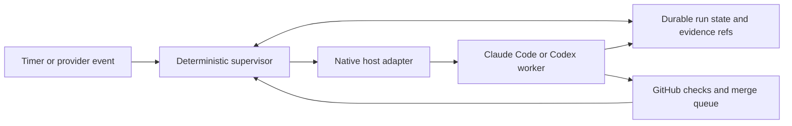

# Durable orchestration for NoaCG

Assessed 2026-10-16 against NoaCG `720cf2abf`, Claude Code 2.1.296, Codex CLI
0.163.0-alpha.5, Node 24.13.0, and the primary sources linked below. This is a development
workflow design, not a product feature. **Code**, **observed**, **documented** and **proposed**
are different evidence levels throughout this report.

## Recommendation

Keep NoaCG's plan/wave semantics and native Claude Code/Codex workers. Put a deterministic
supervisor outside the workers' execution environments. For the eventual hosted control plane,
use **Temporal for durable timers, messages and recovery**, with small NoaCG host adapters.
Do not replace the agent loop or move phase planning into a new framework. Retain the working
Claude desktop task for locally owned runs while hosted adapters are qualified.

The first implementation is an opt-in local supervisor and adapter protocol. It uses built-in
SQLite to prove ownership, delivery reconciliation and waits without deploying infrastructure.
It is a qualification harness and useful local control primitive, **not the hosted durability
solution**. Reuse its adapter protocol as Temporal Activities; do not grow it into a second
production workflow engine. The evidence and runnable commands are under
[the work spec](../work-specs/durable-runs/spec.md).

Why Temporal despite its setup cost: machine loss, durable waits, retry history and scheduler
outages are the central requirements here. Implementing those across hosts would turn a small
script into an owned workflow service. Temporal supplies that control infrastructure without
requiring either coding harness to be replaced. It still does not host our activity processes,
preserve a coding workspace, grant provider access, or deduplicate arbitrary external effects.
Its recoverability comes from persisted event history and deterministic replay.
[Workflow execution](https://docs.temporal.io/workflow-execution).

## What already works, and where it stops

| Concern | Current authority and verified behavior | Remaining boundary |
| --- | --- | --- |
| Execution recovery | `run-wake.mjs`, `claude-agents.mjs`, `run-wake-gate.mjs`: process inventory, quiet verdicts, quota-stop tail parsing, desktop dispatch prompt | Desktop/machine dependent; no transactional wake delivery or coordinator lease |
| Workflow state | `wave-plan-store.mjs`, `plan-run.mjs`, wave launch/progress ledgers, jobs/landings, work-spec acceptance | `.git/noacg-jobs` survives local worktree removal, not loss of its repository/volume |
| Context recovery | `wave-recover.mjs` joins row, owner, refs, verification, landing and acceptance facts without transcripts; phase findings travel in `carry` | Local authorities; cloud must read GitHub directly and restore checkpointed evidence |
| Hosting | Desktop task, detached awake holder, active session timers; Codex heartbeat guidance | No independently hosted run supervisor or external run-state store is established by this checkout |

**Code findings:**

- `arm` requires Claude desktop and Claude Code session IDs, writes one Wake line and prints task
  arguments. It does not create or confirm the scheduled task. Keep registration, scheduler
  receipt, first successful wake and coding capability qualification as separate facts.
- `wakeVerdict` uses recorded Session lines plus the Wake session, ignores transcript age and
  treats unavailable **or empty** inventories as unknown. The firing normally supplies the
  nonempty inventory. An external checker cannot assume that sentinel exists.
- Quota inspection occurs only for live recorded sessions. If all sessions are absent it returns
  resume before checking quota. A quota error without a reset also resumes immediately. Persist
  explicit usage waits independently of process existence; unknown reset should wait for evidence.
- `runCheck` appends a wake-up note before delivery. Two checks can both print resume; neither
  output is a delivered receipt. It selects the first resumable run per firing, so other runs can
  wait another interval. A repeatedly failing first run can delay the rest.
- The prompt hook blocks alive/unknown/waiting before model processing, passes resume/idle with
  the result, and deliberately fails open on exceptions. It matches only the whole scheduled-task
  envelope. This is a cost gate, not a security or ownership gate.
- The task prompt uses `send_message` to the original desktop conversation, falls back to Skill
  execution on send failure, disables on idle, and archives task runs. The repository allows the
  check/send/list/update operations. `archive_session` is allowed in this machine's untracked
  `.claude/settings.local.json`, not in the shared settings. Creation is a separate operation.
- The comments record default permission behavior measured on 2.1.295. Current documentation
  says desktop tasks have a configurable permission mode. Preserve the original conversation's
  policy where verified; require policy equivalence before replacing it. Do not generalize the
  earlier observation to every installed version.
  [Desktop task permissions](https://code.claude.com/docs/en/desktop-scheduled-tasks#permissions-for-scheduled-tasks).
- The awake holder covers Windows/macOS idle sleep until deadline/report. It cannot survive a
  powered-off host as an executing process or prevent closed-lid sleep. Desktop catches up once
  for missed schedules within seven days, rather than replaying every interval.
  [Missed desktop runs](https://code.claude.com/docs/en/desktop-scheduled-tasks#missed-runs).
- The phase ledger rejects out-of-order and repeated launches **sequentially**. Its read then
  append is not a cross-process compare-and-swap. `openWaves` also still uses a six-hour mtime
  heuristic when excluding competing waves. Those are qualification gaps for distributed
  ownership; do not infer that either is a lease. No existing behavior was changed in this slice.
- `resume-dispatch.mjs` already persists intent before launch, preserves uncertain claims and
  refuses automatic reclaim. Reuse this conservative behavior. It is a bounded one-refill pilot,
  not a general run supervisor. `claude-run.mjs` is a foreground bridge with explicit permissions
  and worker receipts; PID presence alone does not prove identity or completion.
- `wave-tick` appends events before replacing its snapshot and tolerates replay, `wave-watch`
  reports degraded observations, and `wave-launch progress` scopes reports to attempt and SHA.
  Reuse them. `queue-merge.md` already requires one acknowledged repair owner, real coding wake
  qualification, bounded repairs and a mergeability check where conflicts have no webhook.

**Observed local state:** seven recent stored plans were 9,389 to 58,242 bytes. Six had Wake
lines; all seven had reports. One was stopped with a blocker and two had unfinished work at a
time limit. Ledger completion and report/window completion are different facts. Reading only
the last transcript is unnecessary and could miss that distinction. No live wave was modified.
Earlier [cross-harness evidence](../metrics/2026-09-11-cross-harness-orchestrator.md) and
[recovery work](../metrics/2026-09-13-orchestrator-durable-recovery.md) already reject treating
a missing PID, worker-ready claim or successful scheduling call as proof of safe adoption.

## Shortlist

| Option | Persists/recovery | Native workers and integration | Adoption judgment |
| --- | --- | --- | --- |
| Current scripts + deterministic supervisor | Existing ledgers plus claims, waits, wake intents and receipts; local disk recovery | Existing workers, small custom adapters; no agent-loop replacement | Best incremental local slice. A hosted implementation also needs durable storage, scheduler/service operations and receiver fencing |
| Pi Durable | Conversations, documents, model/tool task checkpoints, submissions and usage | Own Pi harness/model loop. Wrapping Claude Code/Codex as a custom tool is possible, but is a new adapter, not native session integration | Strong implementation lessons; do not migrate our agents into it |
| Beads | Dependency graph, issue history, claims, memories and async gates | Official Claude/Codex CLI setup integrations; harness-independent task interface | Optional task-memory component. Duplicates our execution/acceptance ledgers and does not itself restart coding hosts |
| nitodeco/Ralph | Local JSON PRD/progress and session metadata; bounded iteration retries | Invokes Claude Code and Codex CLI; custom adapter commands and workflow | More overlap than reuse; default inactivity and permission behavior need changes |
| snarktank/Ralph | Git, PRD status and progress text between fresh iterations | Shipped loop supports Amp and Claude Code. Codex needs an adapter/fork | Good fresh-context pattern; insufficient recovery control |
| Temporal | Workflow history, durable timers/messages, Activity outcomes/retries | Custom Activities can drive native CLIs/app-server/cloud dispatch without replacing agents | Recommended hosted control substrate; highest initial integration/operations cost |

### Pi Durable

The package explicitly remains experimental. SQLite/JSONL persist locally; a Cloudflare Durable
Object SQLite adapter provides a hosted option. A single process owns a store; it has no
cross-process locking. SQLite uses WAL with NORMAL synchronization, so newest commits may be
lost on power/host failure. Its provider session identity improves cache affinity; compaction,
reset/handoff and usage records are built in. This is integration with models through Pi AI,
not resumption of Claude Code or Codex conversations. Provider credentials/billing follow that
model transport; subscription-equivalent operation has not been established for this proposal.
[Package README](https://github.com/earendil-works/pi/blob/main/packages/durable/README.md).

The useful reusable idea is intent/result separation: default interrupted tools do not replay;
safe-replay tools need their own idempotency. Submissions have request IDs, tasks checkpoint
phases, waits and retries; external effects remain outside a transaction with the provider.
Hosting must reopen storage, restore extension definitions and recreate execution environments.
This is more invasive than adapting our deterministic `nextStep` and worker harnesses.
[Normative specification](https://github.com/earendil-works/pi/blob/main/packages/durable/docs/spec.md).

### Beads

Current Beads uses Dolt, not the older SQLite-plus-JSONL description. Its graph, `ready`, atomic
claims, persistent memories and small JSON queries suit long work. `prime` injects workflow
context and stored memories; actual token overhead depends on that content and was not measured
here. Installing `bd setup claude`/`codex` modifies harness guidance/hooks; it does not replace
either agent loop or provide a cloud-session wake API.
[README](https://github.com/gastownhall/beads).

Embedded mode is single-writer; server mode supports concurrent writers. Cross-machine state
needs a shared server or successful remote push/pull. Offline copies synchronizing later are
not a global coordinator lease. Workspace loss before sync still loses local changes. Dolt
server/remote access adds authentication, backup, upgrade and service operations, but no mandatory
model billing for ordinary graph queries. Pin compatible versions rather than treating a changing
database schema as incidental.
[Dolt architecture](https://github.com/gastownhall/beads/blob/main/docs/architecture/dolt.md).

Human gates require explicit resolution; timer and GitHub gates are evaluated by `bd gate check`.
An external cron/CI/orchestrator must run that check. This is useful waiting-state machinery,
not evidence that Beads hosts recovery after our machine disappears. Migrating NoaCG's phase
order, failure kinds and acceptance distinctions into another task system is not justified by
this missing wake mechanism.
[Gates](https://github.com/gastownhall/beads/blob/main/docs/workflows/gates.md).

### Ralph implementations

nitodeco's implementation really launches the coding CLIs, rather than merely their models.
It stores PRD/progress and has configurable retries, runtime/iteration bounds and saved session
resume metadata. Resume concerns Ralph's iteration state; it does not establish native desktop
conversation recovery, workspace reconstruction or a surviving cloud scheduler.
[README](https://github.com/nitodeco/ralph),
[session manager](https://github.com/nitodeco/ralph/blob/main/src/lib/services/session-manager/implementation.ts).

Its runner kills a process after an output-inactivity threshold, which can misclassify long
commands or human waits. Its shipped Claude command skips permissions; its Codex command uses
`--full-auto`. We would need custom command/policy changes, explicit waits and external hosting.
Retries can make new paid/subscription turns and reload planning context. No numeric usage
savings are established by source inspection.
[Runner](https://github.com/nitodeco/ralph/blob/main/src/lib/agent.ts),
[command defaults](https://github.com/nitodeco/ralph/blob/main/src/lib/services/config/constants.ts).

snarktank's loop starts fresh agents with Git, `prd.json` and `progress.txt` as memory. It is
small, easy to understand and close to our existing fresh builder/checker approach. The shipped
shell loop supports Amp/Claude, swallows worker failures and starts the next iteration after a
short delay; the Claude invocation skips permissions. It has no durable supervisor lease,
usage-reset wait or independently hosted restart mechanism. Cloud placement needs an external
host, persisted files and a Codex adapter. Ordinary CLI authentication/billing still applies;
fresh context can repeat instruction and planning costs.
[README](https://github.com/snarktank/ralph),
[actual loop](https://github.com/snarktank/ralph/blob/main/ralph.sh).

Integration classification: Beads' harness setup and Temporal's Activity APIs are supported
extension interfaces; Pi would use a custom tool/host adapter. nitodeco's reviewed command
builder fixes its permission flags in source, so changing that behavior needs a patch/fork.
snarktank explicitly invites copying its loop; adapting it to Codex also changes that source.
Neither Ralph implementation supplies a supported desktop-conversation adapter in the reviewed
paths. No third-party implementation code was copied into this slice.

### Temporal

The service preserves workflow history while worker processes disappear. Activities perform
external work; their results are recorded, but an activity that succeeds externally and crashes
before reporting can run again. Every provider dispatch and GitHub write therefore needs an
idempotency key or explicit reconciliation. Workflow replay is not exactly-once external effects.
[Activity definition](https://docs.temporal.io/activity-definition#idempotency).

Signals/Updates can represent owner answers, permission resolutions and worker receipts. Durable
timers cover quota resets and authorized deadlines without an LLM check. Continue-As-New bounds
history; it is distinct from model context compaction. Keep full logs/artifacts outside workflow
history and pass evidence references. Native CLI/app-server adapters remain our responsibility.
[Message passing](https://docs.temporal.io/encyclopedia/workflow-message-passing),
[Continue-As-New](https://docs.temporal.io/develop/typescript/continue-as-new).

Self-hosting requires the Temporal service, persistence, upgrades/monitoring and our activity
workers. Temporal Cloud removes service operation, but still needs a namespace, authenticated
clients and hosted activity execution. It bills Actions and storage separately from agent usage;
healthy checks use zero model tokens but are not zero infrastructure cost. No account, spend
estimate or deployment was assumed or created.
[Cloud pricing](https://docs.temporal.io/cloud/pricing).

**Maintenance snapshot, not durability proof:** all five projects' repository licenses are MIT.
GitHub metadata read on 2026-10-16 showed Pi's durable-path commit `790271cd` on Oct 16, Beads
release v1.3.1 on Sep 30 and main `dff9492c` on Oct 16, nitodeco main `c7405f23` on Sep 11,
snarktank main `6c53cb0b` on Feb 2, and Temporal activity on Oct 16. Repository stars were roughly
116k/28k/21/22k for Pi/Beads/nitodeco/snarktank; the Pi count covers its whole monorepo.
These indicate community size and recency, not tested NoaCG compatibility.
[Pi metadata](https://api.github.com/repos/earendil-works/pi),
[Beads metadata](https://api.github.com/repos/gastownhall/beads),
[nitodeco metadata](https://api.github.com/repos/nitodeco/ralph),
[snarktank metadata](https://api.github.com/repos/snarktank/ralph),
[Temporal metadata](https://api.github.com/repos/temporalio/temporal).

## Compatibility and actual access

| Environment | Supported/documented control | This session's evidence and qualification boundary |
| --- | --- | --- |
| Local Claude desktop | Existing scheduled task + hook + original-conversation send; CLI resume for local history | Code/tests and local auth status verified. Task registration is printed, not confirmed. No real desktop send/restart was performed here |
| Local Claude Code CLI | Noninteractive CLI and saved local sessions; our `claude-run` adapter | Installed 2.1.296 and authenticated. Native session permissions must be preserved; foreground bridge is not a surviving scheduler |
| Local Codex app | Thread heartbeat via exposed `automation_update`; tools name `kind: heartbeat`, `targetThreadId`, prompt, recurrence, status | Existing paused five-minute heartbeat TOML found; view call succeeded. No new heartbeat armed or future firing demonstrated. Local tasks need machine/app availability |
| Local/controlled-host Codex CLI | `codex exec`, Codex SDK local start/resume, app-server thread/turn events and approvals | CLI 0.163.0-alpha.5 inspected. SDK/app-server integration documented, not run. Keep provider rollout state if resuming locally |
| Claude Code cloud | Provider sessions/GitHub tools; cloud routines can start fresh sessions via schedule/API/GitHub | Repo's cloud setup/merge path exists. No cloud routine/token or replacement environment available to this task; no wake qualification claimed |
| Codex Cloud | Published environments and saved task state; installed experimental `cloud exec/status/list` CLI surface | CLI advertises submission to an environment ID and branch, but no environment ID/authenticated dispatch or killed-environment recovery was exercised |
| GitHub Actions | Existing cloud queue/stamp/CI workflows | Durable CI/merge evidence and dispatch host, not a preserved coding conversation or run-state database. No new schedule installed |

The **Codex SDK** controls local Codex threads. The **OpenAI Agents SDK/API** would introduce a
different agent system and API usage; it is not a drop-in Codex session controller. App-server's
`thread/resume` and turn events are appropriate supported integration seams. Resuming returns
history/metadata; it does not recreate lost worker files or prove cloud lifecycle support.
[Codex SDK](https://learn.chatgpt.com/docs/codex-sdk),
[app-server](https://learn.chatgpt.com/docs/app-server).

The exposed heartbeat tool is a local-thread fallback, not a headless HTTP scheduler contract
for an arbitrary cloud executor. Current docs support minute-based tasks inside a chat, reuse
that chat's context, and require an available computer/app for local files. Scheduled permission
settings can differ from an interactive chat; verify them instead of assuming inheritance.
[Scheduled tasks](https://learn.chatgpt.com/docs/scheduled-tasks).

Current Claude routines are a materially useful hosting/dispatch component: they run off the
laptop, use subscription usage and expose an experimental bearer-authenticated API returning a
new session ID/URL. They start fresh sessions, not the original desktop conversation. No
idempotency mechanism was established by the reviewed API reference; an ambiguous fire must
remain unknown until reconciled. Confirm account access, repositories, connectors, branch
permissions and quota behavior in a real trial. Never enable overage or export a desktop OAuth
credential as a recovery shortcut.
[Routines](https://code.claude.com/docs/en/routines),
[fire API](https://platform.claude.com/docs/en/api/claude-code/routines-fire).

Codex Cloud documents per-task saved files, while new tasks start from a published environment.
That makes same-task continuation useful but does not prove reconstruction after environment
replacement. Important work still needs source control and externally stored run checkpoints.
No retention TTL or external same-task-resume API is inferred here.
[Cloud environments](https://learn.chatgpt.com/docs/environments/cloud-environments).

## Concrete state model

**Proposed hosted state**, separate from the existing phase/row execution ledger:

```text
Run: id, objective/spec + acceptance digest, authorization source/scope,
     permission policy + fingerprint, plan/wave kind, current window ID,
     status, checkpoint revision + artifact refs, scheduler receipt/qualification
Window: id, startsAt, deadline, authorizedBy; immutable after admission
Owner: provider, host/environment, session, lease epoch, expiry, last proof
Wait: kind(owner|permission|dependency|usage|transient), reason, until?, evidence
Action: id(run/window/phase/step/attempt), intent, expected refs,
        state(prepared|unknown|accepted|reconciled), result/worker ID, retry budget
Worker: native ID, task/phase, branch, worktree/reconstruction refs, last commit,
        explicit state, verification and result refs
```

Run statuses: active, waiting, reconciling, blocked, finished, cancelled, expired. Waiting is an
explicit fact, not a failed heartbeat. An expired lease authorizes **reconciliation**, never an
unconditional second worker. A human answer clears only its matching wait; a quota reset starts
a turn only within the still-open authorized window. Permission requests remain permission
requests. A healthy provider process can be running a long quiet command.

Keep the 24-hour window cap until the owner explicitly changes it. Overall task identity and
progress can span days and renewed windows. Renewal records a new immutable window without
erasing phase history or changing scope/permissions. Restart, compaction and scheduler catch-up
cannot renew authorization. The local prototype deliberately implements one registered window;
production renewal is proposed, not shipped.

## Recovery protocol

1. A non-model scheduler polls due runs, or a provider event wakes the supervisor. Acquire one
   run owner through the central workflow identity/transaction and increment a fencing epoch.
   Check cancellation, report/completion, deadline, explicit waits and pending intents first.
2. Inspect native worker/session state. Provider failure is unknown; silence is not failure.
   Keep the coordinator's lease/control service heartbeat separate from a coding command's
   output. Reconcile ambiguous dispatch IDs before making any new paid call.
3. Load the bounded checkpoint and authoritative wave revision. Refresh GitHub head, open PR,
   merge queue, all checks and post-land results. Join recorded worker IDs, branch refs and
   commits. Local `jobs` is useful evidence only where that local job store actually exists.
4. Classify each launched step: live worker, queued PR, merged SHA with pending check,
   interrupted worker, explicit blocker, or unknown. Record an already merged phase before
   asking `nextStep`; never build it again. Verify parent acceptance separately from landing.
5. Reuse the original conversation for owner/permission waits, an in-flight investigation or a
   cheap verified native resume. Use a focused replacement at phase boundaries or after host/
   history loss. Reconstruct its own worktree from a pushed branch/commit and checked artifact
   refs. Unpushed files lost with a host are unrecoverable unless checkpointed externally.
6. Write dispatch intent before sending. Use a stable action ID at the receiver. The receiver
   must atomically admit that ID, check current fencing epoch/deadline/policy, and reconcile
   previous workers before launching. Save the returned worker identity as a receipt. Timeout
   after send is unknown, not evidence that the send failed.
7. Only confirmed non-delivery retries automatically: bounded backoff, at most three attempts
   for that intent, honoring Retry-After/reset and the remaining window. Auth/permission
   failures wait for intervention. Never rotate accounts/models/credentials to evade limits.
8. Checkpoint after each decision, dispatch, verification and phase boundary. At closing, retain
   the current checkpoint/commit and stop new steps under the existing horizon rule. Completion,
   cancellation and expiry disable future dispatch. A separate authorized cleanup/repair owner
   handles already queued PRs; expiry is not permission to abandon that ownership silently.

The central owner must also fence **phase transitions and worker launch admission**. Merely
wrapping `run-wake check` leaves the old markdown read/append race intact. Older coordinators
that cannot enforce the fence must be stopped or proved inactive before transfer. A partitioned
worker may finish local work, but cannot acquire new launch authority. Native harnesses can
perform external actions directly, so per-action fencing is a required adapter qualification,
not a guarantee achieved by instructions alone.

External effects are at least once unless the target enforces our idempotency key. GitHub PR
creation reconciles by repository/head branch; queueing checks current head/status/queue entry;
Git pushes use expected refs and existing commits. Arbitrary publish/payment/email actions need
their own durable receiver deduplication or manual reconciliation. Temporal and SQLite cannot
atomically commit a provider action and our receipt together.

Scheduler outage: on recovery, inspect current durable state once per due run, skip expired
windows and coalesce missed checks. Do not replay every missed wake. Keep an independent
last-successful-tick alarm so a stopped scheduler is visible without spending model tokens.
Host replacement: retain the run store/history and evidence outside that host, reconstruct
workers from Git/artifacts, and qualify a replacement before transferring ownership. A local
database copy is not a globally fenced distributed lease.



## Context and usage

Recovery packet target: roughly 2 to 4k tokens, enforced initially as **16 KiB of JSON**, including
derived phase carry. Byte size is not an exact tokenizer measurement. Include objective and
acceptance, current phase/tasks, decisions/constraints, relevant files, branch/worktree/commits,
latest verification, blockers, next action and evidence refs. Do not append whole transcripts,
old tool logs, full worker prompts or a fresh plan of completed work. Keep those retrievable.
The execution environment still loads its own system instructions, skills and tools; a bounded
packet cannot promise a small total model request by itself.

**Measured:** the usage-only reader scanned 146 primary-project top-level transcripts modified
since Oct 12, matched 88 actual scheduled-task envelopes and deduplicated message/request IDs.
Median first positive request input context was **87,106 tokens** (range 77,838 to 90,091), with
median two usage records per session. Totals: 592 ordinary input, 3,443,805 cache-write,
12,979,008 cache-read and 16,453 output tokens. One session had only zero-token usage counters.
These counters neither prove a dollar charge nor determine subscription quota accounting.
The sample spans the gate rollout; no before/after causal savings estimate is claimed.
[Counters and method](../work-specs/durable-runs/evidence/measurements.json).

Tool metadata in those same sessions contained 87 explicit check commands, no native wake sends,
no fallback Skill calls and no Read calls. This sample measures polling context overhead, not
model-assisted coordinator recovery or repeated planning after recovery. The new deterministic
control tests perform zero planning/model calls; provider recovery and repeated-planning costs
remain an explicit measurement gap. A zero-token error counter is not proof of a blocked hook.

The supervisor's inert-process experiment measured about **164 ms** for a healthy CLI check,
**476 ms** for recovery plus duplicate checks, a **612-byte** delivered fixture packet, and
zero model calls. These are control-path measurements on this machine, not hosted latency or
real Claude/Codex context savings. Normal production cadence would dominate recovery latency.

Keep same-conversation resume when its cached state saves work and preserves pending approvals.
Prefer a fresh phase worker when its bounded obligation is enough. Cache reuse is provider/
harness dependent; fresh sessions can still share a stable instruction prefix, and resuming a
huge conversation can still incur substantial cache writes. Record per-adapter uncached input,
cache writes/reads, output, recovery latency, packet bytes, retrieved bytes and repeated planning
turns before comparing costs. Do not compare raw total input as if it were uncached input.

For focused replacements, select the smallest native tool/skill profile that can do the assigned
phase, retain its required repository guidance, and fetch deeper evidence only for the next
action. Measure the harness's loaded instructions/tools as well as the packet. Do not reduce
required guardrails to make the token count look smaller.

## First slice: what runs today

`scripts/run-supervisor.mjs` is opt-in and installs no scheduler. One local SQLite store keeps
immutable authorization/adapter registration, a replaceable checkpoint, explicit waits,
60-second claims with monotonically increasing epochs, and prepared/delivered action receipts.
SQLite transactions serialize simultaneous claims; FULL synchronization/WAL and process-reopen
tests cover local process failure. Put the database outside throwaway worktrees on local disk.
Do not place a live WAL database on a network filesystem or copy only its main file as a backup.

```text
node scripts/run-supervisor.mjs register <absolute-control.sqlite> <manifest.json>
node scripts/run-supervisor.mjs tick <absolute-control.sqlite> [run-id]
node scripts/run-supervisor.mjs status <absolute-control.sqlite> [run-id]
node scripts/run-supervisor.mjs checkpoint <db> <run-id> <packet.json>
node scripts/run-supervisor.mjs wait <db> <run-id> <wait.json>
node scripts/run-supervisor.mjs clear-wait <db> <run-id> "answer or resolution evidence"
node scripts/run-supervisor.mjs finish|cancel <db> <run-id>
node --test scripts/run-supervisor.test.mjs
```

The manifest shape is demonstrated by `fixture()` in the test: version/id/kind, absolute wave
path, explicit authorization source/scope/start/deadline/permissionPolicy, absolute adapter
executable/cwd with literal args, and the packet. Registration does not imply a scheduler receipt.
The registered command is trusted code, launched without a shell. Its permission-policy string
is a required contract, **not a sandbox implementation**. No live provider adapter ships yet.

Adapters read one JSON request on stdin and return one JSON response. `inspect` returns
running with workerId, gone, unknown, or waiting with kind/reason/until. `reconcile` looks up the
stable actionId and returns delivered with workerId, absent, or unknown. `deliver` returns
delivered with workerId, confirmed not-delivered, or unknown. It accepts/enqueues work promptly;
it does not wait for the whole model task. Each call has a 10-second/64-KiB bound. Every delivery
carries authorization, fence/lease end, action ID and the bounded packet.

An adapter must make absence authoritative relative to its dispatch journal and reject stale
epochs at the receiving end. Without those guarantees it must return unknown. The test adapter
deduplicates with its own SQLite action journal and launches only inert Node processes.
This demonstrates the required mechanism but does not establish idempotency for desktop
`send_message`, a routine fire or Codex cloud submission.

Verified scenarios: quiet healthy coordinator; forced coordinator termination; fresh supervisor;
simultaneous and repeated ticks; supervisor termination after external delivery and before its
receipt write; lease expiry using an advanced test clock; explicit human/permission/dependency
waits; quota wait and reset including a live quota-stopped coordinator; bounded retry/backoff;
stale owner fencing; terminal report/finish/cancel/expiry; immutable scope/policy; bounded packet
including a large ledger carry. See [verification](../work-specs/durable-runs/evidence/verification.md).

Not demonstrated: host reboot, power-loss durability, real native-session restart, actual cloud
workspace deletion/replacement, remote fencing, real scheduler outage/catch-up, native approval
continuation, and comparative provider recovery token usage. No cloud environment was provisioned
and no wake-up was armed during this implementation.

## Migration and the next qualification

1. Preserve the current desktop task/hook. Exercise this supervisor only on a separate test run;
   register no production run under two independent recovery owners. Run the existing wake,
   phase and wave tests alongside its process tests.
2. Qualify a local native adapter: capture exact session identity and permissions, demonstrate
   healthy inspection without a model, kill/restart, reconcile duplicate delivery and a permission
   wait. If the desktop send cannot be deduplicated, keep it conservative/unknown rather than
   claiming exactly once. Preserve the default hook's quiet behavior.
3. Create one private Temporal namespace/control workflow and activity executor, plus private
   durable wave/checkpoint artifacts. This is the first infrastructure/account/spend boundary;
   obtain the owner's choice before provisioning. Pin versions and add replay/versioning tests.
4. Trial Claude cloud routines as the first provider-hosted dispatcher because its documented API
   returns a session receipt under subscription usage. Obtain the per-routine token through the
   provider's supported account flow. Prove read/push/log/check/queue and PR repair ownership,
   test quota and permission behavior, then destroy the worker environment and recover from the
   external checkpoint. Keep ambiguous fires parked until proven resolved.
5. Trial Codex separately. Use a controlled host with Codex CLI/SDK/app-server for the most
   controllable adapter; qualify provider Cloud only with a real environment ID and supported
   lifecycle/status interfaces. A local thread heartbeat is not proof of cloud replacement.
6. Transfer one real run only after the hosted wake has produced evidence. Freeze the previous
   owner's dispatch, reconcile workers/PRs and record the new owner/qualification receipt. Add
   explicit renewed windows later without erasing progress. Keep the GitHub merge flow unchanged.

The genuinely missing prerequisites are an independently hosted control executor and durable
state/artifact location, owner-approved service access/cost, provider cloud account/environment
access, and a demonstrated idempotent or conservatively reconcilable native dispatch. More
prompt text or a framework install cannot supply them.
